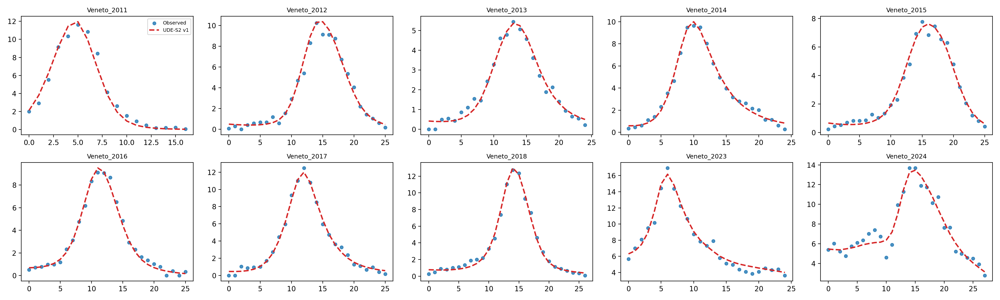
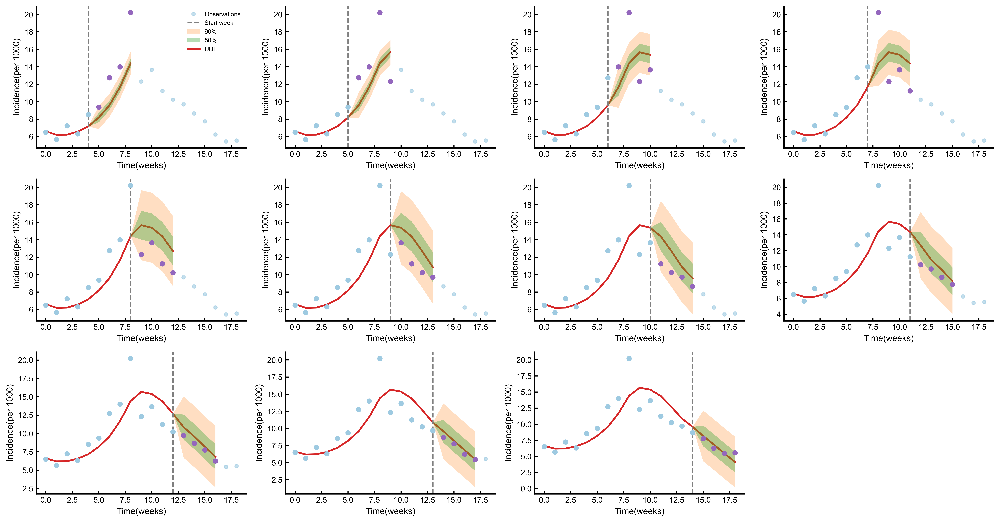

# Physics-informed Forecasting

This repository provides the implementation of a two-stage, physics-informed framework for influenza-like illness (ILI) forecasting, intended to accompany the associated research paper. The Veneto region of Italy is included as an example of the complete training and forecasting workflow.

The framework learns a time-varying transmission rate, β(t), from meteorological and seasonal features using outputs from physics-informed neural networks (PINNs). It then refines the transmission network through an epidemiological dynamical model and produces rolling forecasts of weekly ILI incidence.

**Precomputed PINNs results are included; retraining the PINNs is not required to run this example.** The repository contains the PINNs output data rather than the PINNs training implementation. Trained models from both stages and the fitted meteorological feature scaler are also provided.

## Method Overview

```text
Precomputed PINNs outputs (β, S, E, Is, Ia)
                         ↓
Stage 1: Meteorological and seasonal features → CNN + TCN → PINNs β fitting
                         ↓
Stage 2: Predicted β → Daily dynamical simulation → Weekly incidence fitting
                         ↓
Target season: Initial PINNs calibration → β smoothing → Dynamical simulation
                         ↓
Weekly model updates using available observations → Four-week rolling forecasts
```

### Stage 1: Transmission Rate Pretraining

`Stage_1.py` trains the transmission network, `TransNet`, using daily transmission rates estimated by the PINNs as supervision.

- **Meteorological inputs:** temperature and absolute humidity over the preceding 56 days, standardized using `StandardScaler`.
- **Seasonal inputs:** sine and cosine encodings of the day of year and the relative week within the epidemic season.
- **Architecture:** a CNN encodes each meteorological window. The resulting features are concatenated with seasonal features and processed by a temporal convolutional network (TCN) with causal dilated convolutions and residual connections.
- **Output:** a daily transmission rate β, constrained to `(0, 1)` by a sigmoid activation.
- **Objective:** mean squared error (MSE) between the predicted and PINNs-estimated transmission rates.

The default configuration uses 20,000 epochs and a learning rate of `1e-3`. A separate model and scaler are fitted for each region.

### Stage 2: Refinement Through Epidemiological Dynamics

`Stage_2.py` initializes the network with the Stage 1 weights and couples the predicted transmission rates to an epidemiological model with susceptible (S), exposed (E), symptomatic infectious (Is), and asymptomatic infectious (Ia) compartments.

The first row of each season's PINNs results supplies the initial compartment states. The script advances the dynamics using Euler-style updates with a one-day time step and sums daily incidence over seven-day periods to obtain weekly incidence. The first 50 epochs retain the PINNs transmission-rate objective; a scheduled weighting subsequently shifts training toward fitting observed weekly incidence.

The default configuration uses up to 300 epochs, an initial learning rate of `1e-4`, and a randomly selected validation subset containing 20% of the weekly samples. Learning-rate scheduling and early stopping are enabled. The saved checkpoint contains the model weights at the end of training.

### Rolling Forecasting

`Sliding_window_prediction.py` loads the Stage 2 model and performs the following steps:

1. Calibrate the model against the available PINNs transmission rates for the target season. The included Veneto 2025 example provides 35 days, corresponding to the first five weeks. The script uses all available transmission-rate values in the supplied PINNs file, up to the season length.
2. Predict the seasonal transmission-rate sequence and apply Savitzky–Golay smoothing with a default window length of 7 and polynomial order of 3.
3. Simulate the epidemiological dynamics from the PINNs initial states and aggregate daily incidence into weekly incidence.
4. Begin forecasting after the first five weeks, forecasting four consecutive weeks at each origin and advancing the origin by one week.
5. By default, update the model every week using valid incidence observations preceding the forecast origin, retaining the weights from the previous update.
6. Visualize the forecasts with estimated 50% and 90% intervals derived from historical residual root mean square (RMS) values under a normality assumption.

The setting `start_week=5` uses zero-based indexing, so the first forecast window covers season weeks 6–9. The plotted intervals are residual-based estimates; independent interval-coverage calibration is not included.

## Repository Structure

```text
physics-informed-forecasting/
├── README.md
├── data/
│   ├── ILI_data/                       # Weekly ILI observations for Veneto
│   ├── PINNs_results/                  # Precomputed daily states and transmission rates
│   └── processed_climate_data/
│       └── Veneto_Climate_Daily.csv    # Daily meteorological data
├── model/
│   ├── Veneto_Stage1.pt                # Trained Stage 1 model
│   ├── Veneto_Stage2.pt                # Trained Stage 2 model
│   └── scaler_Veneto.pkl               # Fitted meteorological feature scaler
├── figures/
│   ├── Stage1_Veneto.png
│   ├── Stage2_Veneto.png
│   └── UDE_Pred_Veneto_2025_sliding.png
└── scr/
    ├── Transmission_network.py         # CNN encoder and TCN transmission network
    ├── Stage_1.py                      # Stage 1 training
    ├── Stage_2.py                      # Stage 2 training
    └── Sliding_window_prediction.py    # Calibration, rolling updates, and forecast plots
```

The source directory is named `scr`; retain this name when following the commands below.

## Example Data and Configuration

| Setting | Default value |
| --- | --- |
| Region | Veneto |
| Training season labels | 2011–2018, 2023, 2024 |
| Forecast season label | 2025 |
| Meteorological history window | 56 days |
| Forecast horizon | 4 weeks |
| Forecast origin increment | 1 week |
| Initial PINNs calibration | 200 epochs, learning rate `1e-5` |
| Rolling incidence updates | 50 epochs every week, learning rate `5e-6` |

Years in filenames identify epidemic seasons. The actual date range is determined by the first and last `year_week` entries in the ILI file and may span two calendar years. The training seasons are selected explicitly through `TRAIN_CONFIG` in the two training scripts; the presence of a data file does not automatically include that season in training.

### Input Formats

| Data | File pattern | Required columns | Temporal resolution |
| --- | --- | --- | --- |
| ILI observations | `data/ILI_data/{Region}_{Year}.csv` | `year_week`, `incidence` | Weekly |
| PINNs results | `data/PINNs_results/{Region}_{Year}.csv` | `S`, `E`, `Is`, `Ia`, `beta` | Daily |
| Meteorological data | `data/processed_climate_data/{Region}_Climate_Daily.csv` | `datetime`, `temperature_c`, `absolute_humidity` | Daily |

- `year_week` follows the ISO year-week format, for example `2025-43`. The season extends from the Monday of the first listed week to the Sunday of the last listed week.
- `incidence` is supplied as weekly incidence per 1,000 people. The scripts divide it by 1,000 internally and restore the original scale for plotting.
- PINNs files contain no date column. Rows must correspond to consecutive days beginning at the season start, with the first row providing the initial compartment states.
- Meteorological records must be continuous and cover the period from 56 days before the season start through the season end, without missing values in the required features.
- For training, daily PINNs sequences must align with the observed weekly series and cover complete weeks.

## Usage

Install the dependencies listed at the end of this README, then enter `scr` from the repository root. Data and output paths are resolved relative to the current working directory, so run the Python scripts from `scr`.

### Forecast Using the Provided Model

```bash
cd scr
python Sliding_window_prediction.py
```

The script loads `Veneto_Stage2.pt`, `scaler_Veneto.pkl`, and the example data, performs calibration and rolling forecasting, and generates:

```text
figures/UDE_Pred_Veneto_2025_sliding.png
```

Forecasting includes gradient-based model updates. Updated weights remain in memory for the current run; the script does not separately export the calibrated model or forecast values as CSV files.

### Repeat Both Training Stages and Forecasting

From the repository root, run:

```bash
cd scr
python Stage_1.py
python Stage_2.py
python Sliding_window_prediction.py
```

Training overwrites the corresponding model and scaler files in `model/` and the associated plots in `figures/`. Back up the provided artifacts before retraining if they need to be retained.

### Adapt the Example to Another Region or Season

Prepare data in the formats described above, then edit `TRAIN_CONFIG` in both training scripts and `PREDICT_CONFIG` in the forecasting script. Region identifiers must match the filenames. Stage 2 and forecasting must use the model and scaler for the corresponding region.

Forecasting options are defined in `FINETUNE_CONFIG`, `SMOOTH_CONFIG`, `SLIDING_CONFIG`, and `SLIDING_FINETUNE_CONFIG`. The current forecasting loop advances by one week explicitly; changing `slide_step` alone does not change the actual increment.

The included example replays a historical epidemic season using meteorological data available for the entire season. Prospective forecasting requires meteorological information or forecasts available at each forecast origin. The default smoothing procedure also operates on the full seasonal transmission-rate sequence. Experiments should therefore specify meteorological data availability and observation cutoff dates.

## Example Results

Stage 1: predicted transmission rates compared with the PINNs estimates.


Stage 2: simulated weekly incidence compared with observations.



Forecasting: four-week rolling forecasts for the Veneto 2025 season.



## Requirements

The implementation uses Python and automatically selects a CUDA GPU when available; otherwise, it runs on the CPU. 

| Software / package | Version |
| --- | --- |
| Python | 3.10.20 |
| `torch` | 2.13.0+cu132 |
| `numpy` | 2.2.6 |
| `pandas` | 2.3.3 |
| `matplotlib` | 3.10.9 |
| `scikit-learn` | 1.7.1 |
| `joblib` | 1.5.3 |
| `scipy` | 1.15.3 |
